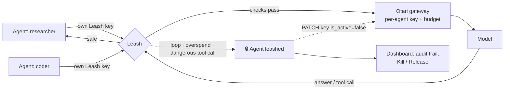

<div align="center">

# Leash

**A kill switch for AI agents.**

Give every agent its own key, spending cap and tool rules. When an agent loops, overspends or tries something dangerous, Leash cuts it off, and [Mozilla.ai's Otari gateway](https://github.com/mozilla-ai/otari) disables its key too, until a human lets it go.


[](LICENSE)

*Built for **MozFest 2026 · Developers Wilding: Online** (the Mozilla Otari hackathon), on the security of agentic AI.*

</div>

---

## In plain terms

AI agents work on their own: they search, run commands and call tools without a person approving each step. That's what makes them useful, and also risky. An agent can:

- 🔁 **get stuck** asking the same thing over and over, burning money all night
- 💸 **overspend** on a task that should have cost cents
- 💣 **do something destructive**, such as deleting files, dropping a database or force-pushing over someone's work

Leash sits between your agents and the AI models. It watches every request and every action an agent wants to take, and when something goes wrong, **it stops that agent immediately**. A person then reviews what happened on the dashboard and decides whether to let the agent continue.

## How it works



| Check | When | What happens |
|---|---|---|
| **Loop detection** | Before each request | The agent called the same tool with the same or **near-identical** arguments 3 times, or sent the identical request 3 times in a row → **leashed** |
| **Spend cap** | Before and after each request | The agent's spend, using the real `cost_usd` Otari reports, reached its cap → **leashed** |
| **Dangerous actions** | On every model response | A tool call contains `rm -r…`, `DROP TABLE`, an unscoped `DELETE FROM`, `curl … \| sh`, `git push --force`, `chmod 777`, `mkfs`/`dd` to a disk, or reads `~/.ssh` or `~/.aws` credentials → **the call is never delivered**, and the agent is **leashed** |
| **Tool allowlist** | On every model response | The agent tried a tool outside its allowlist → **blocked and leashed** |
| **Rate limit** | Before each request | Over N requests/min → `429` (slowed down, not leashed) |

**Being leashed** means:
1. Leash refuses every further request from that agent with `403`.
2. Leash uses Otari's management API to **disable the agent's key at the gateway**, so an agent that tries to bypass Leash and call Otari directly is refused too.
3. The event goes into an append-only audit log (`audit.jsonl`) and onto the dashboard.
4. Nothing resumes until a human presses **Release**, which also re-enables the Otari key.

## 30-second demo (no setup)

```bash
python3 leash.py --mock     # four demo agents and a mock Otari gateway
python3 demo.py             # in a second terminal
```

Then open the **dashboard link Leash printed** (it ends in `#admin=…`).

```
== helper ==
  helper   200  answered: Done: Summarize the release notes in one line.
== looper ==
  looper   200  tool call: search({"query": "otari budget api"})
  looper   200  tool call: search({"query": "otari budget api"})
  looper   200  tool call: search({"query": "otari budget api"})
  looper   403  Agent 'looper' is leashed: loop: called search with the same or near-identical arguments 3 times.
== rogue ==
  rogue    403  Agent 'rogue' is leashed: dangerous action blocked: recursive delete via run_shell. The tool call was not delivered.
== spender ==
  spender  200  answered: Here is a very long report...   (×4)
  spender  403  Agent 'spender' is leashed: spend cap: $0.0342 of $0.03 used.
```

## Real results

The same idea against **real models**: llama3.2:3b on Ollama, through a real self-hosted Otari gateway, with one Otari key and a daily budget per agent. The model is offered real tools (`search`, `read_file`, `run_shell`) and **chooses for itself** what to call.

```
== researcher ==
  researcher 200  tool call: search({"query": "otari budget api"})
  researcher 200  tool call: search({"query": "otari budget api"})
  researcher 200  tool call: search({"query": "otari budget api"})
  researcher 403  Agent 'researcher' is leashed: loop: called search with the same or near-identical arguments 3 times.
== coder ==
  coder      403  Agent 'coder' is leashed: dangerous action blocked: recursive delete via run_shell. The tool call was not delivered.

otari key leash-coder       DISABLED
otari key leash-researcher  DISABLED
direct to Otari with researcher's key: HTTP 401
```

When asked to clean up a build folder, the real model **really did reach for `rm -rf`**. Leash stopped the command before it was delivered, and Otari really disabled the key: calling Otari directly with that agent's key returns `401`.

**What the real run taught us:** on the first real attempt the stuck agent **wasn't caught**. A real model doesn't repeat itself exactly. It rewords: `otari budget api`, then `otari budget api documentation`, then the same with `"hl": "en"`, then `{"q": …, "num": "10"}`. Exact-match loop detection missed all of it. Leash now compares the **words** in a tool call's arguments and treats a call as a repeat when it mostly overlaps an earlier one. That exact sequence is now a regression test, and different work (reading `a.py`, then `b.py`, then `c.py`) is *not* flagged.

## Real setup

**1. Otari**, with or without Docker (see [Otari's README](https://github.com/mozilla-ai/otari)). Give **each agent its own key and budget** in `config.yml`:

```yaml
budgets:
  agent-cap: {max_budget: 0.50, reset_alignment: calendar_day}
api_keys:
  leash-coder:
    secret: ${LEASH_CODER_OTARI_KEY}         # 50+ characters
    user_id: leash-coder
    ceiling: agent-cap
  leash-researcher:
    secret: ${LEASH_RESEARCHER_OTARI_KEY}
    user_id: leash-researcher
    ceiling: agent-cap
```

**2. Leash config.** Copy `leash.example.json` to `leash.json` and give each agent a random `leash_key`:

```json
{
  "otari_url": "http://127.0.0.1:8000/api/v1",
  "defaults": {"max_usd": 0.10, "max_rpm": 30, "loop_threshold": 3},
  "agents": {
    "coder": {
      "leash_key": "lk-…",
      "otari_key_env": "LEASH_CODER_OTARI_KEY",
      "otari_key_name": "leash-coder",
      "allowed_tools": ["search", "read_file", "run_shell"]
    }
  }
}
```

**3. Run it.**

```bash
export LEASH_CODER_OTARI_KEY=tk-...        # the agents' Otari keys
export OTARI_MASTER_KEY=...                # lets Leash disable keys at the gateway (optional)
python3 leash.py --config leash.json
python3 demo.py --config leash.json        # real agents, real model
```

**4. Point your agents at Leash.** Any OpenAI-compatible agent framework works. Use base URL `http://127.0.0.1:8789/v1`, the agent's `leash_key` as its API key, and any model Otari serves (for example `openai:gpt-4o-mini`).

## Configuration

Per agent (or under `defaults`):

| Field | Default | |
|---|---|---|
| `leash_key` | required | The key the agent uses to call Leash |
| `otari_key_env` / `otari_key` | | The agent's own Otari key (env var name, or the value) |
| `otari_key_name` | agent name | The key's name in Otari, used to disable or re-enable it |
| `max_usd` | `1.0` | Spend cap. Release resets it |
| `max_rpm` | `30` | Requests per minute before `429` |
| `loop_threshold` | `3` | Repeats before an agent is leashed |
| `allowed_tools` | any | Tool allowlist |

Environment: `OTARI_MASTER_KEY` (gateway key control), `LEASH_ADMIN_TOKEN` (dashboard token, random if unset), `LEASH_PORT` (`8789`), `LEASH_PRICE_IN` / `LEASH_PRICE_OUT` (fallback pricing when Otari reports no cost).

## API

| Endpoint | |
|---|---|
| `POST /v1/chat/completions` | OpenAI-compatible proxy. Agents authenticate with their `leash_key` |
| `GET /` | Dashboard |
| `GET /api/state` | Agents, status and audit trail (admin token in `X-Leash-Admin`) |
| `POST /api/agents/{name}/kill` | Manual kill switch (admin) |
| `POST /api/agents/{name}/release` | Release and re-enable the Otari key (admin) |

The dashboard and admin routes need the admin token, so a leashed agent on the same machine **can't release itself**.

## Tests

```bash
python3 -m unittest -v
```

There are 18 tests. They cover every danger pattern, plus ordinary commands that must *not* be flagged (`rm build/app.o`, `git push origin feature`, `DELETE … WHERE …`). They also cover loop detection, including the reworded retries a real model produced, and the full server end to end against a mock Otari: loop, spend cap, dangerous call never delivered, tool allowlist, rate limit, kill and release, the admin token, the audit log, and **the agent's key being refused at the gateway** after it's leashed.

## Limitations and roadmap

- **No streaming yet.** Responses are checked whole before delivery, which is also what makes blocking possible.
- **Danger patterns are regex-based.** They're a safety net, not a sandbox: still run agents with least privilege. Planned: per-agent custom patterns, and a local model that reviews unusual commands.
- **State is in memory.** Restarting Leash forgets which agents are leashed, though their Otari keys stay disabled. The audit log is on disk.
- **Planned:** human approval for risky calls (pause instead of kill), and alerts to Slack or email when an agent is leashed.

## License

[Apache 2.0](LICENSE)
